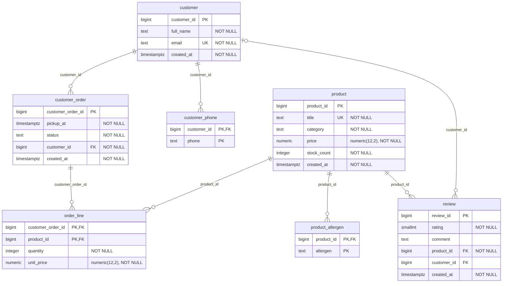

<p align="center">
  
</p>

<p align="center">
  <a href="#see-it-work"><b>See it work</b></a> &nbsp;·&nbsp;
  <a href="#get-started"><b>Get started</b></a> &nbsp;·&nbsp;
  <a href="#what-the-database-enforces"><b>What it enforces</b></a> &nbsp;·&nbsp;
  <a href="../docs/schema-starter/"><b>Interactive page</b></a>
</p>

<p align="center">
  PostgreSQL 16 &nbsp;·&nbsp; Python standard library &nbsp;·&nbsp; 0 dependencies &nbsp;·&nbsp; tested live in CI
</p>

**schema-starter** asks a few plain questions about a business and turns the answers into a
normalized PostgreSQL schema. The rules live in the database itself as constraints. The
schema is deployed in a single all-or-nothing transaction, then read back from
PostgreSQL's catalog and drawn, so you can see exactly what was built.

> Concepts from BU CX651 (Computer Systems), Week 13: normalization and functional
> dependencies, DDL constraints, transactions, and indexes.

## See it work

A real session: each line below is the tool's own output, recorded by
[`assets/make_assets.py`](assets/make_assets.py) and replayed.

<p align="center">
  
</p>

## What you get

| | |
|---|---|
| **A schema in 3NF, without thinking in tables** | Each question is shaped so the answer lands in the right place: a list gets its own table (1NF), a pair table is keyed by both sides (2NF), and a link replaces any copied fact (3NF). |
| **Mistakes caught before any SQL runs** | Repeating groups, copied facts, reserved words, typos and impossible links are all listed at once, each with the rule it breaks and how to fix it. |
| **Rules that every program has to follow** | `NOT NULL`, `CHECK`, `UNIQUE`, `ON DELETE` and identity keys run on every write. The live tests prove PostgreSQL rejects 12 kinds of bad rows. |
| **Deploys that can't half-finish** | One `BEGIN … COMMIT` with `ON_ERROR_STOP`. A deploy that fails partway leaves nothing behind, and a test proves it. |
| **A picture of what was built** | After deploying, the catalog is read back and drawn as an SVG (below) or as Mermaid. The tests check that it matches the spec exactly. |

## Get started

From this folder, with PostgreSQL's `psql` on your PATH:

```bash
python -m schema_starter init                         # answer the questions -> salon.json
python -m schema_starter check salon.json             # every problem, all at once
python -m schema_starter sql salon.json               # the DDL, to read or keep
python -m schema_starter deploy salon.json --db mydb  # create it, then draw it -> salon-erd.md
python -m schema_starter erd --db mydb --schema salon --svg -o salon.svg   # draw any live schema
```

`--db` accepts anything `psql -d` does: a database name, `"host=... port=... dbname=..."`, or a
`postgresql://` URL. Passwords come from `~/.pgpass` or `PGPASSWORD`, and the connection string
is never printed. A second `deploy` won't touch an existing schema; `--replace` drops it (data
included) and starts over.

## Five questions, three normal forms

| You're asked | It becomes | The rule behind it |
|---|---|---|
| What things do you keep track of? | one table each, with an id and `created_at` | every fact in one place |
| What do you record about each one? | columns that depend on that thing alone | 3NF: the key, and nothing but the key |
| Can it have more than one? (`many`) | its own table, one row per value | 1NF: one value per cell |
| Does each X belong to one Y? | a link column, never a copy of Y's facts | 3NF: no transitive dependencies |
| Which things pair up many-to-many? | a pair table keyed by both links | 2NF: the whole key |

The answers are saved as a JSON spec ([`examples/bakery.json`](examples/bakery.json)) that you
can edit and regenerate from. Attributes are written as `name type [required] [unique] [many]`:

```
email email required unique
status choice:placed|ready|picked_up required
stars rating:1-10
phone text many
```

## Mistakes caught before any SQL runs

```
$ python -m schema_starter check salon.json
error: salon.json has problems:
- client: phone1, phone2 is a repeating group (not in 1NF): record one 'phone' attribute
  with "many": true, or make it its own entity
- appointment.starts_at: unknown key 'requird' (allowed: choices, description, many, ...)
- appointment.client_email copies client.email (not in 3NF): appointment already links to
  its client, so store email once, on client. If it's a different fact (like the price at
  the time of sale), give it a name that says so
```

It also catches:
- reserved words (`order` becomes `customer_order`)
- `set null` on a required link
- two links to the same parent without names (`"as": "manager"`)
- required links in a circle, so no row could ever be inserted first
- names that collide or exceed PostgreSQL's 63 characters

## What the database enforces

From [`examples/bakery.sql`](examples/bakery.sql):

```sql
CREATE TABLE customer_order (
    customer_order_id bigint GENERATED ALWAYS AS IDENTITY PRIMARY KEY,
    pickup_at         timestamptz NOT NULL,
    status            text NOT NULL CHECK (status IN ('placed', 'baking', 'ready', ...)),
    customer_id       bigint NOT NULL REFERENCES customer (customer_id) ON DELETE RESTRICT,
    created_at        timestamptz NOT NULL DEFAULT now()
);
CREATE INDEX customer_order_customer_id_idx ON customer_order (customer_id);
```

| Choice | Why |
|---|---|
| `money` is `numeric(12,2) CHECK (>= 0)` | exact: in floating point, 0.1 + 0.2 isn't 0.3 |
| `moment` is `timestamptz` | a real instant, the same in every time zone |
| emails `CHECK (email = lower(email) AND email ~ ...)` | then `UNIQUE` can't be dodged by `Ada@` vs `ada@` |
| required text `CHECK (col <> '')` | `NOT NULL` alone still lets an empty string in |
| `GENERATED ALWAYS AS IDENTITY` | the database hands out ids; an app can't insert its own by accident |
| `ON DELETE`, asked per link | **block** (restrict), **delete them too** (cascade), or **keep them unlinked** (set null) |
| an index on every link column | PostgreSQL indexes primary keys, not foreign keys. Skipped when the column already leads an index |
| `unique_together` | rules like one review per customer per product: `UNIQUE (product_id, customer_id)` |
| one `BEGIN … COMMIT`, run with `ON_ERROR_STOP` | the first error stops psql before `COMMIT`, so the schema is never half built |

## See what you built

The bakery example, read back from a live PostgreSQL and drawn by `erd --svg`:

<p align="center">
  
</p>

`order_line.unit_price` isn't a copy of `product.price`: it's the price when the order was
placed, a different fact, so it has a different name and the 3NF check lets it through.

<details>
<summary>The same diagram as Mermaid (what <code>deploy</code> writes by default)</summary>



`||` exactly one (the link is NOT NULL) · `|o` zero or one · `o{` zero or more · `o|` at
most one (a `unique` link, one-to-one).

</details>

## Tests

```bash
pytest schema-starter                               # offline
SCHEMA_STARTER_TEST_DB=mydb pytest schema-starter   # plus the live ones
```

- **Offline:** every spec check, the DDL (order, checks, indexes, quoting, the transaction), the
  diagrams, a fully scripted `init` session, and that every committed example and graphic
  matches what the tool generates now.
- **Live** (CI runs them against a PostgreSQL 16 service):
  - the diagram read back from the database is identical to the one from the spec
  - PostgreSQL rejects 12 kinds of bad rows: an upper-case or malformed email, empty text, a
    negative price, an unknown choice, a rating of 6, a duplicate review, a link to nothing, an
    id supplied by hand, and more
  - `ON DELETE` restrict, cascade and set null behave as asked, and every link is indexed
  - a script that fails partway leaves no schema behind

The graphics in this README and the [interactive page](../docs/schema-starter/) are
regenerated with `python assets/make_assets.py`.

## Limits

- It creates a schema; it doesn't migrate one. Changing a deployed schema needs a migration tool,
  or `--replace` on a database whose data you can lose.
- Links always point at the parent's id (single-column foreign keys).
- Indexes beyond the links depend on your queries. Check those with `EXPLAIN ANALYZE`: a Seq Scan
  with many "Rows Removed by Filter" is the sign.
