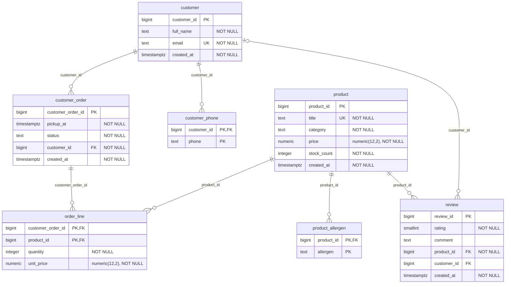

# schema-starter: from "what does your business track?" to a 3NF PostgreSQL schema

A command-line tool that asks a few plain questions about a business and turns the
answers into a normalized PostgreSQL schema. The database enforces the rules itself
with constraints. The tool deploys the schema in one all-or-nothing transaction,
then reads the live database back and draws an ER diagram of what it actually
created.

> Concepts from BU CX651 (Computer Systems), Week 13: normalization and functional
> dependencies, DDL constraints, transactions, and indexes.

Standard library only. It talks to PostgreSQL through `psql`, so there's no driver to
install.

## Run it

```bash
cd schema-starter
python -m schema_starter init                        # answer the questions -> salon.json
python -m schema_starter check salon.json            # every problem at once
python -m schema_starter sql salon.json              # print the DDL
python -m schema_starter deploy salon.json --db mydb # create it, then draw it -> salon-erd.md
python -m schema_starter erd --db mydb --schema salon   # draw any live schema
```

`--db` is anything `psql -d` accepts: a database name, `"host=... port=... dbname=..."`
or a `postgresql://` URL. Passwords come from `~/.pgpass` or `PGPASSWORD`, and the tool
never prints the connection string. A second `deploy` refuses to touch an existing
schema; `--replace` drops it (data included) and starts over.

## The questions follow normalization

| Question | What it becomes | Rule it follows |
|----------|-----------------|-----------------|
| What things do you keep track of? | one table each, with an id and `created_at` | every fact in one place |
| What do you record about each one? | columns that depend on that thing alone | 3NF: the key, and nothing but the key |
| Can it have more than one? (`many`) | its own table, one row per value | 1NF: one value per cell |
| Does each X belong to one Y? | a link column, never a copy of Y's facts | 3NF: no transitive dependencies |
| Which things pair up many-to-many? | a pair table keyed by both links, holding only facts about the pair | 2NF: the whole key |

The answers are saved as a JSON spec ([`examples/bakery.json`](examples/bakery.json)),
so you can edit it and regenerate the schema. Attributes are written one per line, as
`name type [required] [unique] [many]`:

```
email email required unique
status choice:placed|ready|picked_up required
stars rating:1-10
phone text many
```

## The checks catch normalization mistakes before any SQL runs

`check` (and every other command) lists every problem at once:

```
- client: phone1, phone2 is a repeating group (not in 1NF): record one 'phone' attribute
  with "many": true, or make it its own entity
- appointment.starts_at: unknown key 'requird' (allowed: choices, description, many, ...)
- appointment.client_email copies client.email (not in 3NF): appointment already links to
  its client, so store email once, on client. If it's a different fact (like the price at
  the time of sale), give it a name that says so
```

It also catches:
- reserved words (`order` becomes `customer_order`, `user` becomes `app_user`)
- `set null` on a link that's required
- two links to the same parent without names (use `"as": "manager"`)
- required links that go in a circle, so no row could ever be inserted first
- names that would collide or be longer than PostgreSQL's 63 characters

## What the generated DDL does, and why

From [`examples/bakery.sql`](examples/bakery.sql):

```sql
CREATE TABLE customer_order (
    customer_order_id bigint GENERATED ALWAYS AS IDENTITY PRIMARY KEY,
    pickup_at         timestamptz NOT NULL,
    status            text NOT NULL CHECK (status IN ('placed', 'baking', 'ready', ...)),
    customer_id       bigint NOT NULL REFERENCES customer (customer_id) ON DELETE RESTRICT,
    created_at        timestamptz NOT NULL DEFAULT now()
);
CREATE INDEX customer_order_customer_id_idx ON customer_order (customer_id);
```

| Choice | Why |
|--------|-----|
| `money` is `numeric(12,2) CHECK (>= 0)` | exact: in floating point, 0.1 + 0.2 isn't 0.3 |
| `moment` is `timestamptz` | a real moment, the same instant in every time zone |
| emails `CHECK (email = lower(email) AND email ~ ...)` | then `UNIQUE` can't be dodged by `Ada@` vs `ada@` |
| required text `CHECK (col <> '')` | `NOT NULL` alone still lets an empty string in |
| `GENERATED ALWAYS AS IDENTITY` | the database hands out ids; an app can't insert its own by accident |
| `ON DELETE` asked per link | **block** (restrict), **delete them too** (cascade), or **keep them unlinked** (set null) |
| an index on every link column | PostgreSQL indexes primary keys, not foreign keys, and the joins and `ON DELETE` checks need one. Skipped when the column already leads an index (the pair table's key, a `UNIQUE`) |
| `unique_together` | rules like one review per customer per product, `UNIQUE (product_id, customer_id)` |
| one `BEGIN ... COMMIT`, run with `ON_ERROR_STOP` | the first error stops psql before `COMMIT`, so the whole schema is rolled back, never half built |

## The diagram: drawn from the live database

After a deploy, `deploy` reads the catalog (`pg_class`, `pg_attribute`, `pg_constraint`)
back into the same model the DDL came from, and writes Mermaid, which GitHub draws.
This is the bakery as PostgreSQL reports it
([`examples/bakery-erd.md`](examples/bakery-erd.md)):



`||` means exactly one (the link is NOT NULL), `|o` zero or one (it can be NULL), `o{`
zero or more, and `o|` at most one (a `unique` link, one-to-one). `order_line.unit_price`
isn't a copy of `product.price`: it's the price when the order was placed, a different
fact, so it's named differently and the 3NF check lets it through.

## Tests

```bash
pytest schema-starter                                        # offline tests
SCHEMA_STARTER_TEST_DB=mydb pytest schema-starter            # plus the live ones
```

- **Offline:** every spec check, the DDL (order, checks, indexes, quoting, the
  transaction), the diagram's cardinalities, a fully scripted `init` session, and that
  the committed examples match what the tool generates now.
- **Live** (CI runs them against a PostgreSQL 16 service):
  - the diagram read back from the database is identical to the one from the spec
  - the database rejects bad rows: an upper-case or malformed email, empty text, a
    negative price, an unknown choice, a rating of 6, a second review of the same
    product, a link to nothing, an id supplied by hand
  - `ON DELETE` restrict, cascade and set null behave as asked
  - every link has an index
  - a script that fails partway leaves no schema behind

## Limits

- It creates a schema; it doesn't migrate one. Changing a deployed schema means a
  migration tool, or `--replace` on a database whose data you can lose.
- Links are always to the parent's id (single-column foreign keys).
- Indexes beyond the links depend on the queries you'll run. Check those with
  `EXPLAIN ANALYZE`: a Seq Scan with many "Rows Removed by Filter" is the sign.
